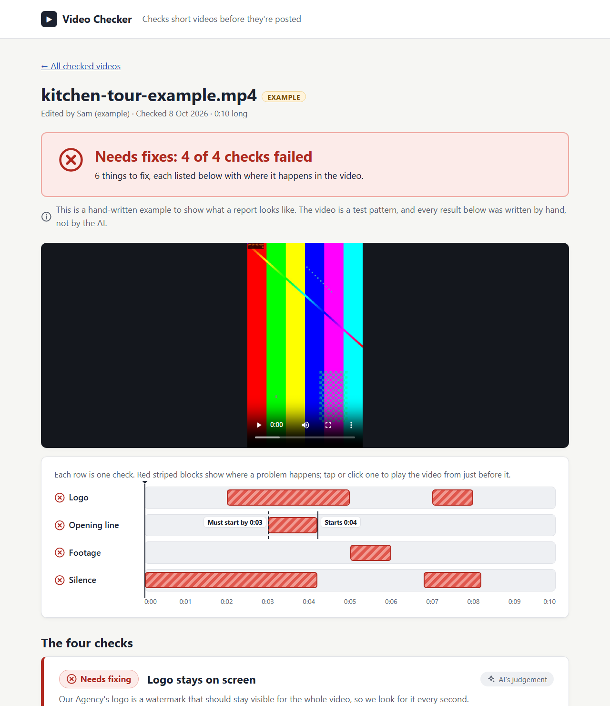

# Video Checker: a QA agent for short-form video

**Live showcase: <https://rhain-r.github.io/content-operations-agent/>** (read-only; works on
phones, tablets and laptops)



Before a short video goes out, someone has to watch it and ask: is our logo on screen the
whole time? Does the opening line start fast enough? Does the footage match what's being
said? Are there awkward silences? This tool does that first pass. An editor uploads a finished
video, an AI reviewer goes through it against a four-point checklist, and the result is a plain
list of what to fix and exactly where, with a timeline you can click to jump to each problem.

## The four checks

1. **Logo stays on screen.** The agency logo is a watermark that should be visible throughout.
2. **Opening line starts quickly.** The spoken hook has to start within the first 3 seconds.
3. **Footage matches what's being said.** B-roll shouldn't contradict the speech.
4. **No silent gaps.** No dead air longer than 1 second.

Each check is labelled either *Measured from the audio* (arithmetic on timestamps) or *AI's
judgement* (the model's opinion of what it saw), so you know which is which. Every report also
says that a person should confirm the AI's review before acting on it.

## What's real and what's simulated

- **Speech is simulated.** Transcription is a placeholder for now: it lays a fixed script over
  the video's real length. The opening-line, footage and silence checks are therefore about
  made-up speech, and every report says so. Swap in a real speech-to-text service and that
  notice disappears (see [Swapping in a real transcriber](#swapping-in-a-real-transcriber)).
- **The logo check is real.** The AI looks at the actual frames.
- **The showcase entry marked "Example"** is a test pattern with a hand-written report. No AI
  was involved, and the page says so.

## How it works

```
upload ─► probe ─► ┌ frames, 1 per second, with exact timestamps ┐ ─► words placed on frames ─► Claude ─► verdict ─► dashboard
                   └ 16 kHz audio ─► transcriber                 ┘     silences measured                   (decided in code)
```

The video is split into one frame per second (with each frame's real timestamp) and a
word-timed transcript. Claude (`claude-sonnet-5-5`) reviews the frames and transcript and
returns a structured report. Anything that is arithmetic, such as silences and timestamps, is
computed in code rather than left to the model, and the final pass/fail is recomputed from the
four checks whatever the model said; the model's own verdict is kept alongside for comparison.

## Run it on your machine

You need Python 3.12, [uv](https://docs.astral.sh/uv/), `ffmpeg` and an
[Anthropic API key](https://console.anthropic.com/).

```bash
git clone https://github.com/rhain-r/content-operations-agent.git
cd content-operations-agent
uv sync
cp .env.example .env
```

Install ffmpeg with `winget install Gyan.FFmpeg` (Windows), `brew install ffmpeg` (macOS) or
`sudo apt install ffmpeg` (Debian/Ubuntu). Put your key in `.env` as `ANTHROPIC_API_KEY=...`.
`.env` is in `.gitignore`; never commit it. Then start the app:

```bash
uv run uvicorn --factory video_qa.main:create_app --port 8000
```

Open **http://localhost:8000**, drop in a video and watch it being checked. Without a key the
dashboard still opens, says the AI reviewer isn't connected, and disables uploads. Set
`SEED_EXAMPLE=true` in `.env` to start with the hand-written Example.

Checking a new video only happens here, on your machine: the public showcase is a static copy
and can't accept uploads, and the API key never goes to GitHub.

## Regenerate the public showcase

The showcase in [`docs/`](docs/) is plain HTML, CSS, JS, images and video with relative links,
published by GitHub Pages. To change what's on it:

1. Put the videos you want public in [`demo_videos/`](demo_videos/). Only these are exported;
   nothing from earlier uploads or `data/` is ever published, and editor names are replaced
   with placeholders such as "Editor A".
2. Run the export (with `ANTHROPIC_API_KEY` in `.env`):

   ```bash
   uv run python -m video_qa.export --videos demo_videos/ --out docs/
   ```

   Each review is saved as `docs/videos/<name>/report.json`. Later runs reuse it and only
   re-render the pages, so changing the design costs nothing; `--refresh` reviews again.
   `--include-example` adds the hand-written Example. Videos that can't be checked are
   skipped and listed. Each web copy is H.264, at most 1280 px, and must stay under 25 MB.
3. Commit and push `docs/`. The [Publish showcase](.github/workflows/pages.yml) workflow
   deploys it to GitHub Pages.

## Configuration

Settings come from environment variables or `.env`; [`.env.example`](.env.example) lists them
all with safe defaults. The main ones:

| Variable | Default | Purpose |
|---|---|---|
| `ANTHROPIC_API_KEY` | unset | Claude API key. Without it, uploads are disabled |
| `ANTHROPIC_MODEL` | `claude-sonnet-5-5` | Model that does the review |
| `AGENCY_NAME` | `Our Agency` | Used in the prompt and the pages |
| `AGENCY_LOGO_PATH` | unset | Reference image of the logo; much more reliable than the name alone |
| `HOOK_DEADLINE_SECONDS` | `3` | The opening line must start by this time |
| `DEAD_AIR_THRESHOLD_SECONDS` | `1` | Silences longer than this are flagged |
| `MAX_FRAMES` | `100` | Sets the longest video accepted (100 frames at 1 per second = 1:40) |
| `MAX_UPLOAD_BYTES` | 500 MB | Upload size cap |
| `NOTIFIER` | `none` | `slack` also messages the editor in Slack on failure |
| `MEDIA_DIR` | `data/jobs` | Where checked videos and frames are kept locally |
| `SEED_EXAMPLE` | `false` | Start with the hand-written Example |

## HTTP API

The dashboard is built on a small JSON API on localhost:

| Endpoint | Purpose |
|---|---|
| `POST /v1/qa-jobs` | Upload (`file`, optional `editor_name`); returns `202` with the job |
| `GET /v1/qa-jobs` | All jobs, newest first |
| `GET /v1/qa-jobs/{id}` | One job: progress, both verdicts and the four check results |
| `GET /v1/qa-jobs/{id}/video` | The uploaded video, with HTTP Range support for seeking |
| `GET /v1/qa-jobs/{id}/frames/{index}.jpg` | One sampled frame |

Rejected uploads return a technical `detail` and a plain-language `message`.

## Swapping in a real transcriber

Anything with this method can replace the placeholder in
[`transcription.py`](src/video_qa/transcription.py):

```python
async def transcribe(self, audio_path: Path) -> list[WordTimestamp]: ...
```

It receives a 16 kHz mono WAV and returns word-level timestamps in seconds. Pass it to
`create_app(transcriber=...)`. Leave out the `simulated = True` flag the placeholder has, and
the "speech is simulated" notice goes away.

## Development

```bash
uv run ruff check .
uv run ruff format --check .
uv run mypy
uv run pytest
```

The tests need ffmpeg but no API key and no network: they build test clips with ffmpeg's
`lavfi` sources and fake the Anthropic transport. [CI](.github/workflows/ci.yml) runs the same
four commands on every push and pull request.

## Notes

- **Code layout.** [`deconstruction.py`](src/video_qa/deconstruction.py) (frames and audio),
  [`agent.py`](src/video_qa/agent.py) (the Claude review),
  [`findings.py`](src/video_qa/findings.py) (all the plain-language wording),
  [`main.py`](src/video_qa/main.py) (API and dashboard), [`export.py`](src/video_qa/export.py)
  (the static showcase).
- **Frame timestamps.** Frames are picked with ffmpeg's `select` filter and labelled with the
  `pts_time` that `showinfo` reports, so a 29.97 fps clip gives 0, 1.001, 2.002, … rather than
  times rounded to a 1 fps grid.
- **Structured output.** The review uses native structured outputs. `messages.create` is
  called with the schema built by the SDK's `transform_schema`, and `stop_reason` is checked
  before the JSON is validated, so refused or cut-off replies raise clear errors.
- **One process.** Jobs are kept in memory, so run a single worker. Several workers would need
  a shared store (for example Redis) behind the `JobStore` interface in
  [`jobs.py`](src/video_qa/jobs.py), shared media storage, and a real queue.

## License

[MIT](LICENSE)
